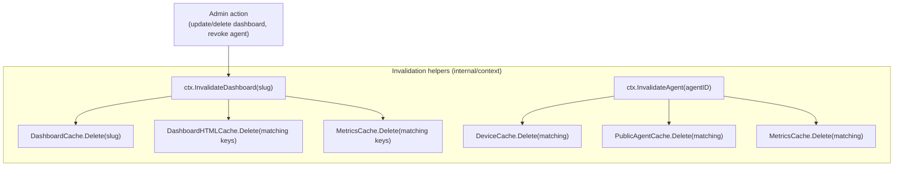

# Caching standards

This page sets the rules for caching HTTP responses in Go handlers, and describes the static asset pipeline. It is for developers. How caching fits into request handling overall is in [architecture](architecture.md#caching-and-request-handling).

## Principles

1. **One place.** All caching logic (lookup, pre-compression, serving, expiry and invalidation) lives in `internal/context`. Handler packages never re-implement compression checks or their own cache maps.
2. **Compress once, on store.** `NewCacheEntry()` pre-compresses each payload with both zstd and gzip when it is stored, so reads under load cost no compression work.
3. **One TTL.** Public telemetry APIs and public server-rendered pages use a 60-second TTL (`ctx.DefaultCacheTTL`).
4. **No ETags on telemetry.** Monitoring data changes within a minute; computing SHA-256 ETags costs CPU and causes cache churn.

## The cache entry

Every cached response is a `*context.CacheEntry`:

```go
type CacheEntry struct {
    Payload     []byte    // Raw uncompressed payload (JSON or HTML)
    GzipPayload []byte    // Pre-compressed gzip payload
    ZstdPayload []byte    // Pre-compressed zstd payload
    ExpiresAt   time.Time // Absolute expiry (time.Now().Add(ttl))
}
```

## Cache registries (`internal/context/key.go`)

| Cache | Kind | Key format | Value | Used for |
|---|---|---|---|---|
| `ctx.MetricsCache` | `ResponseCache` | `slug_agentID_metric_hours` | `*ctx.CacheEntry` | Results of `/api/metrics` |
| `ctx.DashboardCache` | `ResponseCache` | `slug` | `*ctx.CacheEntry` | JSON for `/api/public/dashboard` |
| `ctx.DashboardHTMLCache` | `ResponseCache` | `html_dash_slug` / `html_agent_slug_pubID` | `*ctx.CacheEntry` | Rendered public dashboard HTML |
| `ctx.PublicAgentCache` | `sync.Map` | `dashboardID_publicAgentID` | `*ctx.PublicAgentCacheEntry` | Public ID to internal agent lookup |
| `ctx.DeviceCache` | `sync.Map` | `device_id` | device identity | Token lookup for agent ingestion |
| `ctx.StaticCache` | `sync.Map` | relative file path | `*ctx.CacheEntry` | Pre-compressed static assets (`/static/*`) |

Real public cache keys also contain the dashboard's immutable ID and current configuration version; see [architecture](architecture.md#caching-and-request-handling).

### `ResponseCache`: the bounded response caches

The three response caches share one budget (`bounded_cache.go`):

- **128 MiB** of payload across all of them, counting the raw, gzip and zstd payloads.
- Least recently used entries are evicted when the budget is full.
- Expired entries are removed on access, and in bulk by `ExpireResponses()` on maintenance.
- `CacheStatistics()` feeds the `response_cache` figures in the hourly maintenance log.

`ResponseCache` has the same `Load`, `Store`, `Delete` and `Range` methods as `sync.Map`, so handlers use it the same way.

## Handler pattern

### Cache hit

```go
if entry, hit := ctx.GetCacheEntry(&ctx.TargetCache, cacheKey); hit {
    entry.Serve(w, r, contentType, http.StatusOK)
    return
}
```

### Cache miss, public and expensive: coalesce the build

For public handlers whose result is costly to build, call `ctx.BeginBuild` (`coalesce.go`) before building:

```go
finish, leader := ctx.BeginBuild(w, r, cacheKey, retryHandler)
if !leader {
    return // BeginBuild already answered: served via retry, or rejected
}
defer finish()
// build payload, then store and serve as below
```

- The first request for a key becomes the **builder**. Identical requests that arrive meanwhile wait up to 2 seconds for it, then run `retryHandler`, which re-checks permissions and serves the cached result.
- At most 32 builds run at once, and waiting followers share a 64-slot budget. When either is full, the request gets 503.
- The builder spends one build from the caller's per-IP quota; followers spend none. An exhausted quota gets 429.
- `BuildStatistics()` feeds the `builds` figures in the maintenance log.

Examples: `internal/metrics/handler.go` and `internal/dashboard/public.go`.

### Store and serve

```go
entry := ctx.NewCacheEntry(payload, ctx.DefaultCacheTTL)
ctx.TargetCache.Store(cacheKey, entry)
entry.Serve(w, r, contentType, http.StatusOK)
```

### What `entry.Serve` does

`Serve(w, r, contentType, status)` handles content negotiation:

- It reads `Accept-Encoding`, including quality values.
- If the client accepts `zstd` and a zstd payload exists, it sends that with `Content-Encoding: zstd`.
- Otherwise, if the client accepts `gzip` and a gzip payload exists, it sends that with `Content-Encoding: gzip`.
- Otherwise it sends the raw payload.
- It sets `Content-Type` and adds `Vary: Accept-Encoding`.
- It sets `Cache-Control: no-store` **unless the handler already set a `Cache-Control` header**. Browsers therefore don't cache dynamic responses by default; the server still does.

## Invalidation

Invalidate explicitly, on every change that affects cached data:



- **Dashboard updated or deleted:** call `ctx.InvalidateDashboard(slug)`.
- **Agent revoked or its key reset:** call `ctx.InvalidateAgent(agentID)`.

## Don't

- Don't check `Accept-Encoding` in handlers. Use `entry.Serve(w, r, ...)`.
- Don't create `&ctx.CacheEntry{}` directly. Use `ctx.NewCacheEntry(payload, ttl)`.
- Don't compute SHA-256 ETags for telemetry.
- Don't create ad-hoc cache maps in handler packages. Register caches in `internal/context`.
- Don't clean up expired entries by hand. `ctx.GetCacheEntry()` removes expired entries when it reads them.

## Static asset pipeline (`internal/minify`)

Static files (`/static/*`) are processed once at startup by a pure-Go pipeline:

1. **Minify:** `minify.CSS()` and `minify.JS()` strip comments and collapse whitespace.
2. **Fingerprint:** `minify.Fingerprint()` adds an 8-character SHA-256 content hash to the name, such as `base.8f3b9a12.css`.
3. **Integrity:** `minify.Integrity()` computes the SHA-256 base64 Subresource Integrity hash (`sha256-...`).
4. **Pre-compress:** results are stored in `ctx.StaticCache` with `LongCacheTTL` (1 year), as zstd and gzip payloads.
5. **Templates** use `{{asset "admin/js/admin_alerts.js"}}` and `{{integrity "admin/js/admin_alerts.js"}}` to insert the fingerprinted URL and SRI hash. Paths start with the asset area; see [frontend JavaScript build](frontend-js-build.md).
6. **Browser caching:** `Cache-Control: public, max-age=31536000, immutable`, or `private, …` for admin assets.
